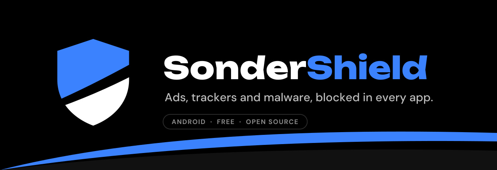

<p align="center">
  
</p>

<p align="center">
  <a href="https://github.com/Verisonder/SonderShield/releases/latest"></a>
  <a href="https://github.com/Verisonder/SonderShield/releases"></a>
  
  <a href="LICENSE"></a>
  <a href="https://github.com/Verisonder/SonderShield/actions/workflows/checks.yml"></a>
</p>

<p align="center">
  <b>Ad, tracker and malware blocker for Android and Windows.</b><br>
  No root needed, no account, no analytics. Everything stays on your phone.
</p>

<p align="center">
  <a href="https://github.com/Verisonder/SonderShield/releases/latest"><b>⬇ Download the APK</b></a>
</p>

---

## What it does

SonderShield runs a local VPN on your phone. Every app's DNS lookups go through it: names on your block lists get nothing back, the rest go on to the DNS server you pick, encrypted by default. Nothing is sent to any SonderShield server, because there isn't one.

Turn on **HTTPS filtering** and it goes further in your browsers: ad spaces and anti-adblock walls are removed from the page itself.

## Features

| | |
|---|---|
| **Blocks everywhere** | Every app on the phone, through a DNS-only VPN. No speed or battery cost from routing. |
| **Good lists, ready** | StevenBlack, AdGuard (DNS, Base, Mobile, Tracking, Social), EasyList, uBlock Origin, HaGeZi, OISD, URLhaus, Phishing Army, plus regional lists switched on for your language. Add any list by URL (hosts, AdBlock or plain domains). |
| **Your rules win** | Block or allow any domain, subdomains included. Test a domain to see which list or rule decides. |
| **HTTPS filtering** | Hides ads inside pages in the browsers you pick, with element hiding and scriptlets from the lists. Uses a certificate made on your phone. Banks, payments and government sites are never touched. |
| **Encrypted DNS** | DNS over HTTPS with Cloudflare, Quad9, Google, AdGuard, or your own server. |
| **WireGuard** | Import a `.conf` and your traffic leaves through your own server or VPN provider, still filtered. |
| **Root mode** | On rooted phones, blocks without a VPN so another VPN can run alongside. |
| **Live log** | Every lookup, with the app that asked. Search, filter, and block or allow from a tap. |
| **Per-app control** | Let an app that breaks skip SonderShield, or cut an app off the internet entirely (firewall). |
| **Always there** | Quick Settings tile, home screen widget, start on boot, always-on VPN. |
| **Yours to shape** | Pure black, light, system or Material You theme, any accent colour. English, French and German. |
| **Portable** | Export and import your settings; export the log as CSV. |

## Install

**Android:** download the APK below. **Windows:** download `SonderShield-Setup-x.y.z.exe` from the latest release and install it (or the portable `SonderShield-Windows-x.y.z.exe`) (Windows asks for administrator rights to change the PC's DNS and firewall).

1. Download `SonderShield-x.y.z.apk` from the [latest release](https://github.com/Verisonder/SonderShield/releases/latest) and open it.
2. Follow the first-run steps: allow the VPN, keep it running in the background.
3. Tap the shield.

**Private DNS:** if Android's Private DNS is set to a specific provider, lookups go straight there and skip SonderShield. The app warns you; set it to Automatic or Off.

**HTTPS filtering:** Settings › HTTPS filtering. Save the certificate, install it from Android's settings (the app shows where), and pick your browsers. Firefox needs one extra switch, shown in the app.

## How it is built

```
engine/   Go: DNS and packet handling, list parsing, rules, cache, DoH,
          gVisor netstack full tunnel, WireGuard, HTTPS filtering
app/      Android app: Kotlin and Jetpack Compose
tools/    build_engine.sh: engine -> app/libs/engine.aar (gomobile)
engine/cmd/sondershield/  the Windows app (Go + embedded web UI)
```

The engine is plain Go with its own tests, bound to Android with gomobile and reused directly by the Windows app (`engine/cmd/sondershield`).

### Building

Needs JDK 17, the Android SDK with an NDK, and Go 1.24+.

```sh
(cd engine && go mod tidy)
tools/build_engine.sh          # engine -> app/libs/engine.aar
gradle assembleDebug
```

Engine tests: `cd engine && go test -race ./...`

## Privacy

No account, no analytics, no crash reporting sent anywhere. The log and statistics live on the phone. Block lists are downloaded straight from their authors. The HTTPS certificate is created on the phone and never leaves it.

## Licence

[GPL-3.0-only](LICENSE). Block lists belong to their authors and keep their own licences. Fonts: Unbounded and DM Sans, SIL Open Font License.

<p align="center"><sub>By <a href="https://github.com/Verisonder">Verisonder</a></sub></p>
